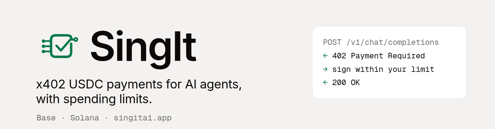

<div align="center">

<picture>
  <source media="(prefers-color-scheme: dark)" srcset="assets/banner-dark.png">
  
</picture>

[](https://www.npmjs.com/package/@singitai/sdk)
[](https://pypi.org/project/singit/)
[](https://registry.modelcontextprotocol.io/v0/servers?search=singit)
[](https://github.com/SingItAi/SingItAI/actions/workflows/security-gate.yml)
[](https://github.com/SingItAi/SingItAI/blob/main/LICENSE)
[](https://singitai.app)

**[Website](https://singitai.app) · [Docs](https://singitai.app/docs/) · [Quickstart](https://singitai.app/docs/quickstart/) · [MCP](https://singitai.app/docs/mcp/) · [Integrations](https://singitai.app/integrations/) · [Status](https://singitai.app/status/) · [Numbers](https://singitai.app/numbers.json)**

</div>

---

## What SingIt is

SingIt lets AI agents pay for things with **x402 USDC payments and spending limits**, on **Base and Solana**. One OpenAI-compatible endpoint with 150+ models, paid per answer from your own wallet. No account is needed for direct x402 calls.

## Install

| Language | Package | Install |
|---|---|---|
| TypeScript / JavaScript | [`@singitai/sdk`](https://www.npmjs.com/package/@singitai/sdk) 0.1.0 | `npm install @singitai/sdk` |
| Python | [`singit`](https://pypi.org/project/singit/) 0.1.0 | `pip install singit`<br>Solana: `pip install "singit[svm]"` |
| MCP (remote, no local install) | [`app.singitai/singit`](https://registry.modelcontextprotocol.io/v0/servers?search=singit) 0.1.3 | `claude mcp add --transport http singit https://app.singitai.app/mcp --header "Authorization: Bearer $SINGIT_API_KEY"`<br>Free tools work without a key. Other clients: [MCP docs](https://singitai.app/docs/mcp/) |

## Quickstart

**1. Try it free.** No wallet and no key. Six models answer free; the default allowance is 20 answers per visitor network per UTC day, and a shared daily cost cap can use it up earlier (`429 free_budget_exhausted`, resets at 00:00 UTC).

```bash
curl https://ask.singitai.app/v1/chat/completions \
  -H 'Content-Type: application/json' \
  -d '{"model":"free/deepseek-v4.1-flash","max_tokens":60,
       "messages":[{"role":"user","content":"Reply with the single word: pong"}]}'
```

Free models: `free/deepseek-v4.1-flash`, `free/openai-gpt-oss-20b`, `free/gemma-4-e2b`, `free/gemma-3-27b-it`, `free/mistral-small-3.2-24b-instruct`, `free/qwen3-coder-30b-a3b-instruct`.

**2. Pay for a call with the SDK.** Spend limits are checked in your process before anything is signed.

```js
import { SingIt } from "@singitai/sdk";

const singit = new SingIt({
  evmPrivateKey: process.env.AGENT_PRIVATE_KEY, // a wallet with a little USDC on Base
  network: "base",
  maxPerCallUsd: 0.01,
  maxPerDayUsd: 1,
});

const answer = await singit.chat({ messages: [{ role: "user", content: "Hello" }] });
console.log(answer.choices[0].message.content, answer.payment);
```

Prefer to see the offer first? An unpaid request to a paid model returns `402` with a `PAYMENT-REQUIRED` header you can decode. The full walkthrough is in the [5-minute quickstart](https://singitai.app/docs/quickstart/).

## How limits work

- **SDK limits** (`maxPerCallUsd`, `maxPerDayUsd`) are client-side. They run in your process before signing; they are not on-chain. The daily counter lives in memory per SDK instance and UTC day.
- **Wallet limiter rules** apply only to wallets that granted SingIt an allowance, and constrain spending through that allowance (the SingIt app's own agent). They do not cover other agents or independently signed x402 payments. On Base, the limiter contract holds the daily cap, per-purchase cap and expiry on chain. On Solana, SingIt's server enforces them, and on chain only the total SPL delegate amount is fixed. Details: [wallet spending limits](https://singitai.app/agent-spending-limits/).
- **API keys** carry server-enforced daily and per-request caps and an expiry. See [Limits](https://singitai.app/docs/limits/).

## Repositories

| Repo | What it is |
|---|---|
| [**SingItAI**](https://github.com/SingItAi/SingItAI) | The open-source monorepo: SDKs (`sdk/`), the Ask service (`singit-ask/`), the gateway and MCP server (`sign402-gateway/`) and the AgentAllowance contract (`agent-allowance/`). MIT. |

## Links

[singitai.app](https://singitai.app) · [Developers](https://singitai.app/developers/) · [Models](https://singitai.app/models/) · [Pricing](https://singitai.app/pricing/) · [Live status](https://singitai.app/status/) · [Measured numbers](https://singitai.app/numbers.json) · [Security policy](https://github.com/SingItAi/SingItAI/blob/main/SECURITY.md) · [contact@singitai.app](mailto:contact@singitai.app)
